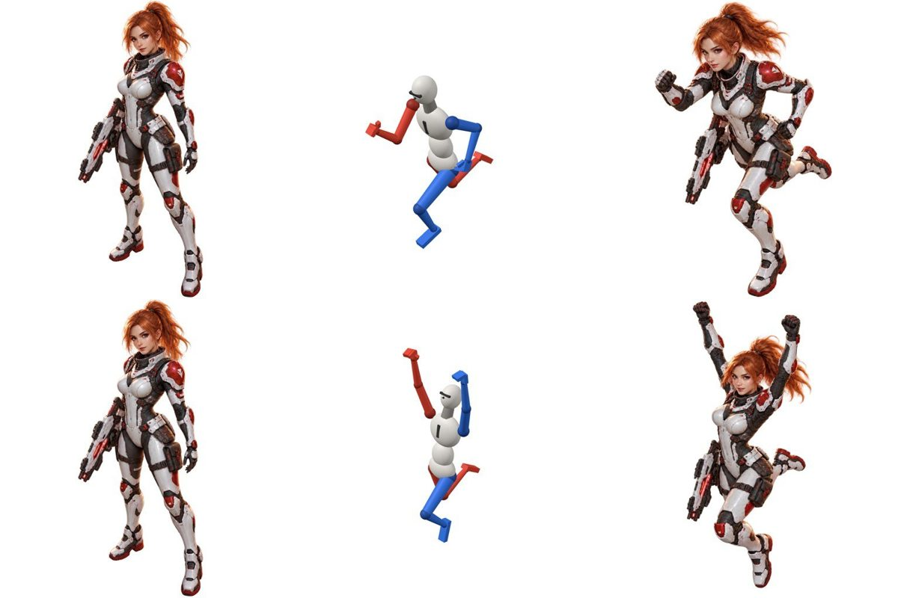

# pose-doll

[English](README.md) | 日本語

人型キャラクタに狙ったポーズを取らせるための Claude スキルです。

3D のポーズ人形を JSON（または GUI のエディタ）で動かして、ポーズ参照画像を描きます。
その画像をキャラ画像と一緒に画像生成（gpt-image スキルの edit）へ渡し、「このキャラでこのポーズ」の画像を作ります。
文章だけでポーズを指定すると左右や手足の位置を取り違えやすいので、人形の画像で指定します。



## できること

- **ポーズ人形の描画**：JSON で関節角度を指定し、ヘッドレス Chromium で PNG に描きます。
  - 画像上の左右で書いたポーズ説明文（英語）も出力します。そのままプロンプトになります。
- **キャラ画像の生成**：gpt-image スキルの `edit` を呼び、キャラ画像と人形画像から生成します。
  - 旧版の gpt-image-2-5 スキルしか無い環境でも動きます。
  - 生成結果は、キャラ／人形／結果を並べた確認画像と一緒に出力されます。
- **アニメーションのコマ一式**（`frames.py`）：
  - ポーズ × 向きを一括で作ります。
  - 縮尺を固定し、再生順の GIF と比較シートで確認できます。
  - 候補から採用する案を選べます。
- **ほかの画像生成ツール向けの書き出し**（`--export`）：
  - OpenPose 画像と関節 JSON（ControlNet 用）、深度画像、マスク、プロンプト文を書き出します。
  - gpt-image スキルが無くても使えます。
- **GUI エディタ**：部位をクリックしてスライダーで動かします。
  - 「プロジェクトに保存」で名前を付けると、Claude にその名前でポーズを指示できます。
- **持ち物**：銃（10種）、剣（片手・両手・刀・短剣・斧）、盾（5種）、杖・槍を持たせられます。
- **写真からポーズを作る**（任意、`photo2pose.py`、MediaPipe）
- **キャラ本人の3Dモデルを使う**（任意、Meshy でリギングした GLB）

## インストール

スキル本体は `pose-doll/` フォルダです（`SKILL.md` と `scripts/`）。

- **Claude Code（個人用）**：
  ```bash
  git clone https://github.com/Sinme52/pose-doll.git
  cp -r pose-doll/pose-doll ~/.claude/skills/
  ```
- **Claude Code（プロジェクト用）**：`pose-doll/` をプロジェクトの `.claude/skills/` に置きます。
- **claude.ai**：[`pose-doll.zip`](https://github.com/Sinme52/pose-doll/raw/main/pose-doll.zip) をダウンロードして、設定の「スキル」からアップロードします。
  - 同じ zip は Claude Code でも使えます。`~/.claude/skills/` に展開してください（中に `pose-doll/` フォルダが入っています）。
  - ただし描画にはブラウザ（Chromium）が必要です。claude.ai のチャット環境では動かないことがあります。

### 必要なもの

- Node.js 20 以上（22 で動作確認）。three.js 0.170 の必要な部分は `scripts/node_modules/three` に同梱しています。
- Playwright と Chromium（描画用）。初回だけ、スキルのフォルダの外に入れます。
  ```bash
  npm install --prefix ~/.cache/pose-doll playwright && npx --prefix ~/.cache/pose-doll playwright install chromium
  ```
  グローバルや作業ディレクトリに Playwright があれば、それを使います。
  **`scripts/` の中で `npm install` を実行しないでください。** 同梱の three.js が消えます。
- Python 3 と Pillow（`pose2image.py` / `frames.py`）
- 生成する場合：gpt-image スキル（`edit` コマンドがあるもの。旧版の gpt-image-2-5 も可）と OpenAI の API キー
- 任意：`pip install mediapipe`（写真から作る場合）、meshy-cli（3Dモデルを作る場合）

## 使い方

Claude に頼むのが基本です。

- 「akane をライフルを構えたポーズで」
- 「この写真のポーズで描いて」
- 「歩行のコマを dl と ul で作って」
- 「ポーズ人形を開いて」（エディタが起動します）
- 「ComfyUI で使うポーズ素材を書き出して」

手で動かす場合は、プロジェクトのフォルダで次のように実行します（`$SKILL` はスキルのフォルダ）。

```bash
node $SKILL/scripts/server.mjs --port 5178                  # エディタ → http://localhost:5178
node $SKILL/scripts/render.mjs run --view facing-lower-left # 人形を描く → ./pose-doll-out/run.png
python3 $SKILL/scripts/pose2image.py --character hero.png --pose run --dry-run
```

- 出力は作業ディレクトリの `pose-doll-out/` に出ます。
- エディタで保存したポーズは `pose-doll-poses/` に保存されます。
- スキルのフォルダには書き込みません。

詳しい手順と注意点は [pose-doll/SKILL.md](pose-doll/SKILL.md) にあります。

## テスト

```bash
cd pose-doll/scripts && npm test   # Node のテストと Python のテスト
```

`pose-doll/` の中を変えたら、スキルの zip を作り直して、変更と一緒にコミットします。

```bash
python3 build-zip.py          # pose-doll.zip を作る（テストとキャッシュは除く。同じファイルなら同じ zip になる）
python3 build-zip.py --check  # pose-doll.zip が古ければ失敗する
```

GitHub Actions が、push と pull request のたびに `npm test`（`.github/workflows/tests.yml`）と `--check`（`.github/workflows/zip-check.yml`）を実行します。

## ライセンス

[MIT License](LICENSE)（Copyright (c) 2026 Sinme52）

- スキルのフォルダにも同じ `pose-doll/LICENSE` を入れているので、zip で配布してもライセンス表記が残ります。
- 同梱の three.js は、three.js authors による MIT ライセンスです（`pose-doll/scripts/node_modules/three/LICENSE`）。
