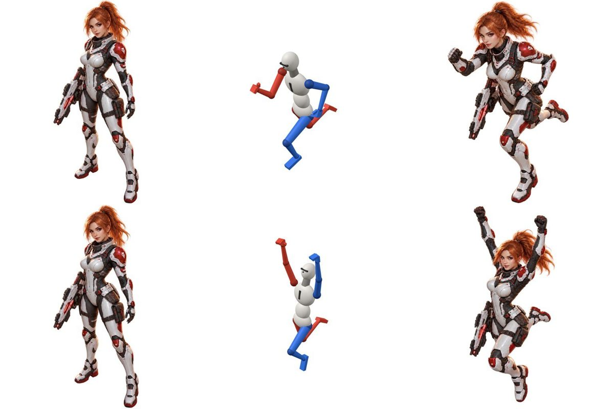

# pose-doll

English | [日本語](README.ja.md)

A Claude skill for putting a humanoid character into the exact pose you want.

You pose a 3D doll with JSON (or in the GUI editor) and render it as a pose reference image.
That image goes to image generation together with your character image (the `edit` command of the [gpt-image skill](https://github.com/Sinme52/gpt-image)), and you get "this character in this pose".
Describing a pose in words alone often mixes up left and right or where the hands and feet go, so the pose is given as a doll image instead.



## Features

- **Render the pose doll**: set joint angles in JSON and render a PNG with headless Chromium.
  - It also outputs a pose description (in English) written in terms of the picture's left and right, ready to use as a prompt.
- **Generate the character image**: calls the `edit` command of the gpt-image skill with the character image and the doll image.
  - It also works where only the older gpt-image-2-5 skill is installed.
  - Each result comes with a check image that shows the character, the doll, and the result side by side.
- **Animation frame sets** (`frames.py`):
  - Makes every pose × direction combination in one go.
  - Keeps the scale fixed, and lets you check the frames as a GIF in playback order and as a comparison sheet.
  - Lets you choose which candidate to keep.
- **Export for other image generators** (`--export`):
  - Writes an OpenPose image and joint JSON (for ControlNet), a depth image, a mask, and the prompt text.
  - Works without the gpt-image skill.
- **GUI editor**: click a body part and move it with the sliders.
  - Give a pose a name with "Save to project", and you can ask Claude for that pose by name.
- **Props**: guns (10 kinds), swords (one-handed, two-handed, katana, dagger, axe), shields (5 kinds), staff and spear.
- **Make a pose from a photo** (optional, `photo2pose.py`, MediaPipe)
- **Use a 3D model of the character itself** (optional, a GLB rigged with Meshy)

## Install

The skill itself is the `pose-doll/` folder (`SKILL.md` and `scripts/`).

- **Claude Code (personal)**:
  ```bash
  git clone https://github.com/Sinme52/pose-doll.git
  cp -r pose-doll/pose-doll ~/.claude/skills/
  ```
- **Claude Code (project)**: put `pose-doll/` in the project's `.claude/skills/`.
- **claude.ai**: download [`pose-doll.zip`](https://github.com/Sinme52/pose-doll/raw/main/pose-doll.zip) and upload it under Settings > Skills.
  - The same zip also works for Claude Code: unzip it into `~/.claude/skills/` (it contains the `pose-doll/` folder).
  - Rendering needs a browser (Chromium), so it may not work in the claude.ai chat environment.

### Requirements

- Node.js 20 or later (tested on 22). The parts of three.js 0.170 it needs are bundled in `scripts/node_modules/three`.
- Playwright and Chromium (for rendering). Install them once, outside the skill folder:
  ```bash
  npm install --prefix ~/.cache/pose-doll playwright && npx --prefix ~/.cache/pose-doll playwright install chromium
  ```
  A global Playwright, or one in the working directory, is used if present.
  **Do not run `npm install` inside `scripts/`.** It removes the bundled three.js.
- Python 3 and Pillow (`pose2image.py` / `frames.py`)
- To generate images: the gpt-image skill (a version with the `edit` command; the older gpt-image-2-5 also works) and an OpenAI API key
- Optional: `pip install mediapipe` (to start from a photo), meshy-cli (to make a 3D model)

## Usage

Usually you just ask Claude:

- "Draw akane aiming a rifle"
- "Draw her in the pose from this photo"
- "Make walking frames facing dl and ul"
- "Open the pose doll" (starts the editor)
- "Export pose assets for ComfyUI"

To run it by hand, run these in your project folder (`$SKILL` is the skill folder):

```bash
node $SKILL/scripts/server.mjs --port 5178                  # editor → http://localhost:5178
node $SKILL/scripts/render.mjs run --view facing-lower-left # render the doll → ./pose-doll-out/run.png
python3 $SKILL/scripts/pose2image.py --character hero.png --pose run --dry-run
```

- Output goes to `pose-doll-out/` in the working directory.
- Poses saved in the editor go to `pose-doll-poses/`.
- Nothing is written to the skill folder.

Detailed steps and caveats are in [pose-doll/SKILL.md](pose-doll/SKILL.md) (in Japanese).

## Tests

```bash
cd pose-doll/scripts && npm test   # Node and Python tests
```

After changing anything under `pose-doll/`, rebuild the skill zip and commit it with the change:

```bash
python3 build-zip.py          # writes pose-doll.zip (no tests or caches; same bytes for the same files)
python3 build-zip.py --check  # fails if pose-doll.zip is out of date
```

GitHub Actions runs `npm test` (`.github/workflows/tests.yml`) and the `--check` (`.github/workflows/zip-check.yml`) on every push and pull request.

## License

[MIT License](LICENSE) (Copyright (c) 2026 Sinme52)

- The skill folder has the same `pose-doll/LICENSE`, so the license stays with the files when you distribute them as a zip.
- The bundled three.js is under the MIT License by the three.js authors (`pose-doll/scripts/node_modules/three/LICENSE`).
